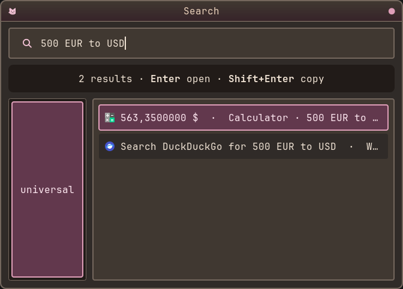
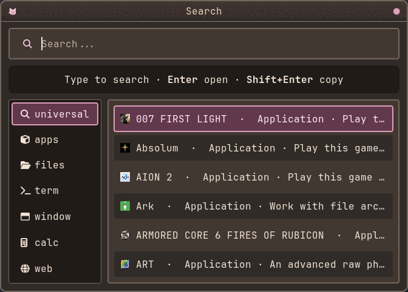

# rofi-universal

**One launcher. One search field. Multiple capabilities. Automatic intent detection.**

`rofi-universal` is a single Rofi mode that combines applications, native
calculations, currency conversion, web searches, files, clipboard history,
bookmarks and a few productivity shortcuts into one live search interface. It is inspired
by KDE KRunner and macOS Spotlight, but stays lightweight and uses ordinary
command-line tools instead of a background daemon or an AI service.

Unlike Rofi script modes, it is a native Rofi plugin. Results refresh as you
type, and you do not need to switch modes or remember a prefix for normal use.

Rofi-universal code is based on https://github.com/unkindypie/.maya-dotfiles 
by Maya the goddess of coding herself.

## Features

- **Live combined results** from all enabled providers as you type, with
  duplicate results for the same provider and target collapsed.
- **Tabbed launcher:** starts on the universal tab while keeping Rofi's
  apps/files/term/window modes; `calc` is added automatically when the
  `rofi-calc` plugin is available, and extra modes can be appended with
  `ROFI_UNIVERSAL_EXTRA_MODI`.
- **Independent provider relevance scoring** with simple, maintainable rules:
  intents are no longer exclusive, so one query can produce useful app, file,
  calculator, web and clipboard results at the same time.
- **Clear textual result descriptions** identify provider and action, such as
  `File · open · ~/Downloads` or `Calculator · copy result`, without custom
  markup or a mandatory theme.
- **Applications** from the freedesktop desktop-entry database, matching names,
  generic names, keywords, desktop IDs and executables. A query may start with an
  application name (`steam games`) without letting every catalogue entry outrank
  the application itself.
- **Calculator** implemented natively in C: arithmetic, parentheses, percentages,
  powers, constants and documented math functions, with no external calculator
  executable. `log`/`ln` are natural logarithms and `log10` is base 10; `%` is
  modulo or postfix percentage. Currency conversion uses Frankfurter reference
  rates (`300 eur to USD`) and remains asynchronous and cached.
- **Web search** with DuckDuckGo, Google, Brave, Bing, Startpage or a custom URL
  template; supports URLs, bare common domains such as `github.com/rofi`, and
  `!g`, `!ddg`, `!w`, `!yt`, `!gh`, `!aur`, `!maps`, `!define`, `!arch`, `!man`,
  `!docs` and `!pkg` shortcuts.
- **Files** through direct path expansion and asynchronous optional `fd` search.
  Filename matches rank above parent-path matches, and glob patterns such as
  `*.png` are supported by `fd`. `Alt+1` reveals a selected file through
  `org.freedesktop.FileManager1`, falling back to opening its containing
  directory; selecting a directory opens it.
- **Clipboard history** through `cliphist`, with explicit `clip ` search and
  optional low-priority automatic matching. The history is cached in memory and
  never written to disk by the launcher. Decoding a selected item is bounded to
  4 MiB and text-only; invalid or binary content is refused rather than copied.
- **Inline dictionary** for `define <word>`, `definition of <word>`,
  `<word> meaning` and `what does <word> mean`. Definitions, part of speech,
  phonetics and examples are shown directly in Rofi when the public
  dictionaryapi.dev service is reachable; browser links remain as fallback.
- **GitHub** search for `github <query>` or `gh <query>`, with repository, user
  and issue actions plus direct `owner/repository` opening. Category-led
  queries such as `github issues rofi` and `github users torvalds` put the
  requested category first.
- **Weather** for `weather in <city>`: an inline summary when `curl` or `wget`
  can reach wttr.in, plus an external detailed-forecast fallback. Results are
  cached in memory. A bare `weather` query uses `[weather] location` if set and
  never silently assumes an IP-based location.
- **Bookmarks** from Chromium-family JSON stores and Firefox/Zen SQLite stores
  when `jq` and `sqlite3` are available, loaded in the background.
- **Keyboard-first**: `Enter` runs the selected result; `Shift+Enter` copies its
  URL, path, value or title to the clipboard.
- **Non-blocking lifecycle**: file searches, clipboard refresh, bookmark loading,
  currency retrieval, inline weather and inline dictionary run asynchronously.
  New queries cancel obsolete work and stale callbacks are rejected by generation
  checks. Subprocess output is bounded per stream. Local arithmetic never waits
  for network or an external binary.

## Screenshot



## Demo



The demo shows the tabbed v1.1 launcher on Maya's Rofi theme: the universal
search tab alongside apps, files, term, window, calc and web; native arithmetic
(`25 * 18`); and inline Frankfurter reference-rate conversion
(`300 eur to USD`) with its rate date. It was recorded through the Super+D
launcher.

## Requirements

### Required

- Rofi **1.7.6+** with plugin support. CI compiles and loads the plugin with
  Rofi **1.7.9** (Fedora 42) and Rofi **2.0.0** (Fedora 44 and Arch Linux).
  Interactive Wayland testing uses Rofi **2.0.0**.
- GLib/GIO and JSON-GLib development headers, a C compiler, Meson and Ninja

The mathematical calculator has no external runtime dependency. Currency
conversion is optional and needs `curl` or `wget` plus network access when a
fresh Frankfurter rate is not already cached.

### Optional providers

| Provider | Dependency |
| --- | --- |
| Files | `fd` (recommended), `timeout` |
| Clipboard | `cliphist`, `wl-clipboard` (Wayland) or `xclip`/`xsel` (X11) |
| Bookmarks | `jq` for Chromium-family, `sqlite3` for Firefox/Zen |
| Inline weather | `curl` or `wget`; network access to wttr.in |
| Inline dictionary | `curl` or `wget`; network access to dictionaryapi.dev |
| Currency | `curl` or `wget`; network access to api.frankfurter.dev |
| URL/file opening | `xdg-open` or the desktop's default URL handler |
| Web search | a browser registered as the default URL handler |

## Install

### Fedora / Nobara — prebuilt RPM

Tagged releases publish prebuilt **x86_64** RPMs for Fedora 42 and Fedora 44.
Download the RPM that matches your Fedora release and verify it against the
published `SHA256SUMS` before installing. No compiler or build tooling is
required:

```sh
sudo dnf install ./rofi-universal-<version>-<release>.fcXX.x86_64.rpm
rpm -q rofi-universal
rofi -show universal -modi universal
```

Upgrade with the newer RPM using `sudo dnf upgrade ./rofi-universal-...rpm`,
and remove with `sudo dnf remove rofi-universal`. User configuration in
`~/.config/rofi-universal/` is not installed or removed by the RPM.

These release RPMs are currently **unsigned**. The SHA-256 manifest provides
integrity verification over HTTPS, not publisher authentication. Do not disable
DNF GPG checks globally or use `--nogpgcheck` as a normal installation method.
DNF may print a warning that OpenPGP checks were skipped for the local unsigned
RPM; that warning is not a signature verification. If your DNF policy requires
signed packages, use the source-build fallback or wait for a signed release. CI
uses `--nogpgcheck` only for locally built test RPMs in an isolated container.

Fedora 42 and Fedora 44 use different Rofi ABIs. Use the RPM built for your
release; do not mix `fc42` and `fc44` packages. Nobara installs matching the
corresponding Fedora release can use the same RPM. Binaries are currently
verified on x86_64 only; aarch64 packages are not yet published.

If no RPM matches your Fedora release, use the source-build fallback below.

### Fedora / Nobara — source-build fallback

```sh
sudo dnf install rofi rofi-devel meson ninja-build gcc pkg-config \
  glib2-devel cairo-devel json-glib-devel
# Optional:
sudo dnf install fd-find cliphist wl-clipboard jq sqlite curl
```

### Arch Linux

```sh
sudo pacman -S --needed rofi meson ninja gcc pkgconf glib2 cairo json-glib
# Optional:
sudo pacman -S --needed fd cliphist wl-clipboard jq sqlite curl
```

### Ubuntu 26.04 LTS / Debian testing

```sh
sudo apt install rofi rofi-dev meson ninja-build build-essential pkg-config \
  libglib2.0-dev libcairo2-dev libjson-glib-dev
# Optional:
sudo apt install fd-find cliphist wl-clipboard jq sqlite3 curl
```

Source build, installation, Rofi plugin loading and uninstallation were verified
in Ubuntu 26.04 LTS and Debian testing with Rofi 2.0.0. No `.deb` package is
currently provided; use the generic installer below.

Debian stable and Ubuntu 24.04 currently ship Rofi 1.7.5, below the required
Rofi 1.7.6, and are not supported.

### Tested environments

- Fedora 42 with Rofi 1.7.9: compiled, plugin-loaded and binary RPM
  installation/upgrade/removal tested in a clean runtime environment.
- Fedora 44 with Rofi 2.0.0: compiled, plugin-loaded and binary RPM
  installation/upgrade/removal tested in a clean runtime environment.
- Arch Linux current with Rofi 2.0.0: package built, installed, plugin-loaded
  and removed in an Arch container in CI.
- Ubuntu 26.04 LTS with Rofi 2.0.0: source build, install, plugin loading and
  uninstall verified.
- Debian testing with Rofi 2.0.0: source build, install, plugin loading and
  uninstall verified.
- Local Wayland/Hyprland with Rofi 2.0.0: interactive manual testing, including
  real FileManager1 reveal with Dolphin 26.08.1 and default-handler directory
  fallback with Thunar.

Debian stable and Ubuntu 24.04 ship Rofi 1.7.5 and are not supported. CI also
runs the source-install and plugin-load lifecycle on Ubuntu 26.04 LTS and Debian
testing.

The Debian/Ubuntu commands below are source-build instructions, verified on
Ubuntu 26.04 LTS and Debian testing. They are not a `.deb` package.

### Fedora / Nobara package builds

The RPM spec is `packaging/rofi-universal.spec`. The tag-driven
`.github/workflows/release-rpm.yml` workflow builds x86_64 RPMs for Fedora 42
and Fedora 44, runs the test suite, installs the package in a clean runtime
container, verifies plugin loading, tests upgrade and removal, and uploads the
RPM with a checksum manifest as a workflow artifact. It does not publish a
release automatically.

The RPM installs only runtime files:

- `%{_libdir}/rofi/libuniversal.so`
- `/usr/bin/rofi-universal`
- license, documentation and an example configuration file under `/usr/share`

It does not install build tools, qalc, or a user configuration file. The RPM
requires `rofi >= 1.7.6` and `json-glib`; optional provider tools remain weak
recommendations. The package is not currently published in Fedora or Nobara
repositories.

To build locally from a release archive:

```sh
sudo dnf builddep packaging/rofi-universal.spec
rpmbuild -ba packaging/rofi-universal.spec
```

### Arch Linux package

A PKGBUILD with a pinned SHA-256 checksum is provided in
`packaging/PKGBUILD`:

```sh
cd packaging
makepkg -si
```

It is built, installed, plugin-loaded, checked with `namcap` and removed in an
Arch Linux container in CI. It is not published in the official Arch
repositories. See [packaging/README.md](packaging/README.md) for the release
archive and checksum procedure.

### Build and install

```sh
git clone https://github.com/Fl1pMoniz/rofi-universal.git
cd rofi-universal
./scripts/install.sh
```

The default prefix is `~/.local`. Use another prefix with `PREFIX=/usr/local`.
The installer builds the plugin, installs `libuniversal.so` under the Meson
plugin directory (`$PREFIX/lib/rofi`, `$PREFIX/lib64/rofi` or a multiarch
`lib/*/rofi` path), installs the `rofi-universal` launcher, and copies an example
configuration to `~/.config/rofi-universal/config.ini` if one does not exist.

Run it:

```sh
rofi-universal
```

Or add a desktop shortcut. For Hyprland:

```ini
bindd = SUPER, SPACE, Universal search, exec, rofi-universal
```

For Sway/i3:

```text
bindsym $mod+space exec --no-startup-id rofi-universal
```

### Run without installing

```sh
meson setup build
meson compile -C build
ROFI_PLUGIN_PATH="$PWD/build" rofi -show universal -modi universal
```

### Uninstall

```sh
./scripts/uninstall.sh
```

Your configuration in `~/.config/rofi-universal/` is preserved.

## Configuration

The configuration file is INI-based. The default path is:

```text
~/.config/rofi-universal/config.ini
```

Override it with `ROFI_UNIVERSAL_CONFIG=/path/to/config.ini`. To use a specific
Rofi theme, set `ROFI_UNIVERSAL_ROFI_CONFIG=/path/to/config.rasi` or pass Rofi
arguments after `rofi-universal`, for example:

```sh
rofi-universal -config ~/.config/rofi/config.rasi
```

Example:

```ini
[general]
max_results=40
web_engine=duckduckgo
open_command=xdg-open

[providers]
applications=true
calculator=true
web=true
files=true
clipboard=true
dictionary=true
github=true
weather=true
bookmarks=true

[files]
roots=~
max_depth=4
max_results=8

[clipboard]
automatic=false
cache_seconds=30
max_results=10

[dictionary]
cache_seconds=86400
timeout_seconds=4

[weather]
location=
cache_seconds=600
timeout_seconds=4

[currency]
cache_seconds=21600
timeout_seconds=4
```

`web_engine` accepts `duckduckgo`, `google`, `brave`, `bing`, `startpage`,
`wikipedia`, `youtube`, `github`, `aur`, `openstreetmap`, `dictionary`,
`wiktionary`, `arch`, `man`, `docs`, `pkg`, or a custom template containing `%s`
or `{query}`.

Disable a provider by setting it to `false`. Disabled providers add no results
and are not queried.

See [docs/PROVIDERS.md](docs/PROVIDERS.md) for the provider support matrix,
dependencies, external-service behavior and current limitations.

## Keyboard shortcuts

| Key | Action |
| --- | --- |
| `Enter` | Open the selected result / copy a calculation |
| `Shift+Enter` | Copy the selected result's URL, path, value or title |
| `Alt+1` | Reveal selected file in file manager; opens a directory |
| `Up` / `Down` | Move selection |
| `PageUp` / `PageDown` | Move by a page |
| `Home` / `End` | Jump to the first/last result |
| `Escape` | Close the launcher |

## Example queries

| Query | Result |
| --- | --- |
| `25 * 18` | Calculator result: `450` |
| `sqrt(144)` | Native function result: `12` |
| `(25 + 15) * 2` | Parenthesized result: `80` |
| `25% of 180` | Percentage calculation: `45` |
| `300 eur to USD` | Currency conversion using a reference rate |
| `1000 JPY to USD` | Currency conversion with yen precision |
| `firefox` | Application (when installed) |
| `firefox 123` | Web search, without a false calculator result |
| `python 3.14 features` | Web search, not a calculation |
| `report.pdf` | Local file search and direct path when it exists |
| `*.png` | Glob file search through `fd` |
| `steam` | Installed application ranked highly |
| `steam games` | Steam itself above its catalogue entries, with web search below |
| `zen` / `kitty` | Application match, with files below |
| `~/Downloads/report.pdf` | Direct file or directory open |
| `define ephemeral` | Inline definition with external reference fallback |
| `definition of ephemeral` | Inline definition, natural-language form |
| `what does ephemeral mean` | Inline definition, natural-language form |
| `github hyprwhispr` | GitHub repository, user and issue search |
| `github issues rofi` | GitHub issue search first |
| `github owner/repository` | Direct repository opening plus search actions |
| `weather in Tokyo` | Inline weather when available, plus an external forecast action |
| `hyprland configuration` | Web search |
| `terminal commands` | Web search, not automatic terminal launch |
| `firefox extensions` | Web search, with Firefox app available |
| `github.com/rofi` | Open the URL with HTTPS |
| `!yt linux customization` | YouTube search |
| `!docs glib main loop` | DevDocs search |
| `clip github` | Search clipboard history |
| `python` | Applications, files and web results ranked together |

## How it works

`rofi-universal` is a native Rofi mode plugin. It uses Rofi's
`_preprocess_input` callback, which runs on every edit, to rebuild a shared result
list and call `rofi_view_reload()`. That is what gives live updates in one mode.

Source layout:

```text
src/
  plugin.c       Rofi callbacks, providers, actions and result merging
  query.c        Query analysis, provider relevance and scoring signals
  process.c      Cancellable asynchronous, output-limited subprocess capture
  fetch.c        curl/wget selection and command construction
  weather.c      Weather location, URL and response parsing
  dictionary.c   Dictionary URL, JSON parsing and cache helpers
  calculator.c   Native expression parser, evaluator and formatter
  currency.c     Currency query parser, Frankfurter JSON and bounded cache
  universal.c    Result model, URL building and configuration
  universal.h    Shared interfaces
tests/
  test_core.c    Query, ranking, URL and configuration tests
  test_process.c Async process, output-limit, timeout and failure tests
  test_weather.c Weather location, URL and response parsing tests
  test_fetch.c   HTTP fetcher selection and command tests
  test_dictionary.c Dictionary URL, JSON parsing and cache tests
  test_calculator.c Native arithmetic, functions, limits and formatting tests
  test_currency.c Currency query, JSON, precision and cache tests
  test_rapid_queries.py Xvfb rapid-query, cancellation and teardown smoke test
  test_file_actions.py Xvfb Alt+1 reveal fallback test
  test_filemanager_dbus.py Mock FileManager1 success-path test
  test_clipboard_actions.py Xvfb clipboard decode/copy test with fake tools
  test_calculator_currency.py Xvfb native calculation and currency tests
  test_query_regression.c Structured query-intent and negative regression cases
  benchmark_core.c Optional query, matching, formatting and dedup benchmark
```

See [docs/ARCHITECTURE.md](docs/ARCHITECTURE.md) for the provider and async
lifecycle details.

Query analysis produces independent signals for applications, calculations, web
search, files, clipboard, dictionary, GitHub and weather. A query can be relevant
to several providers; there is no single provider-suppressing intent. Ranking
combines match quality, provider relevance and a local-action bonus:

1. Application matching takes the strongest of name, executable, keyword and
   desktop-term matches; weak description-only matches are discounted.
2. File matching ranks filename hits above parent-path hits.
3. The query analysis adds provider relevance.
4. Local providers get a small preference over external actions.
5. Results with the same provider and target are deduplicated.
6. Results are sorted deterministically by score, provider and title.

Async work uses a query-generation counter and a per-query `GCancellable`.
Applications, native calculations and local analysis render immediately. File
search, clipboard refresh, bookmark loading, currency retrieval, inline weather
and inline dictionary retrieval run through `src/process.c`; obsolete processes
are cancelled and callbacks for older generations are ignored. Bookmark,
clipboard, currency, weather and dictionary data are held only in memory for the
plugin's lifetime. Subprocess stdout/stderr are capped at 4 MiB per stream;
exceeding the cap marks the operation failed and terminates the child.

No prompt is sent to an AI model. No daemon runs in the background. Network access
only happens when a currency query needs a Frankfurter reference rate, when a
weather query requests an inline summary, when a dictionary query requests a
definition, or when the user chooses a web action. Bookmark stores are read
locally. Currency conversion sends only the base currency code to
api.frankfurter.dev and caches the returned reference rates in memory. Inline
weather requires `curl` or `wget` and sends the requested city to wttr.in. Inline
dictionary requires `curl` or `wget` and sends only the requested word to
dictionaryapi.dev. Browser fallbacks remain when a service or a fetcher is
unavailable.

## Extending

Providers share the live mode state, so their result-building code remains in
`src/plugin.c` with a shared `UResult` representation. Query signals and scoring
live in `src/query.c`; reusable process execution lives in `src/process.c`.

1. Add a score/action in the provider function.
2. Add a `U_PROVIDER_*` value in `src/universal.h` if needed.
3. Add provider relevance in `src/query.c`.
4. Use `u_process_run()` for subprocess work; never block the UI.
5. Add a test in the relevant module test file and extend
   `tests/test_query_regression.c` for new query forms.
6. Run `meson test -C build` and an interactive smoke test.

Please keep new providers local-first and dependency-tolerant. A missing tool
must never prevent the rest of the launcher from working.

## Testing

```sh
meson setup build
meson compile -C build
meson test -C build --print-errorlogs
```

The core tests check query analysis, application/file match helpers, URL
encoding, GitHub/web URL construction, provider relevance, ranking, deduplication,
config and invalid input. The weather, dictionary, calculator and currency tests
use fixtures and do not require network access. The fetch tests check curl/wget
selection and command construction. The process tests cover success, output
limits, partial reads, large stderr, timeout, continuous output, invalid UTF-8,
cancellation, failures and spawn errors. The rapid-query smoke test requires Xvfb
and `xdotool`; it starts Rofi with a fake fetcher, exercises weather and
dictionary requests, and closes the launcher while work is pending. The
file-action test verifies the Alt+1 fallback. The calculator/currency integration
test uses fake `curl` and clipboard helpers to verify native arithmetic and
inline Frankfurter conversion without an external calculator, network access or
the real clipboard.

An interactive smoke test can be run on Wayland:

```sh
ROFI_PLUGIN_PATH="$PWD/build" rofi -show universal -modi universal
```

Then try the example queries above.

A small deterministic benchmark target is available separately from the test
suite:

```sh
meson compile -C build benchmark-core
./build/benchmark-core
```

It measures repeated query analysis, application/file matching, display
formatting and result deduplication on the local machine. See
[docs/BENCHMARKS.md](docs/BENCHMARKS.md) for the methodology and a reference run;
timings are environment-specific and are not used as CI gates.

## Troubleshooting

**`Mode 'universal' not found`**
The plugin path is wrong. `rofi-universal` sets `ROFI_PLUGIN_PATH` automatically.
If launching Rofi directly, point `-plugin-path` or `ROFI_PLUGIN_PATH` at the
directory containing `libuniversal.so`.

**Calculator shows no result**
The calculator is built in and needs no external executable. Check the expression
for balanced parentheses, supported function names and finite values. Division or
modulo by zero, invalid domains and overflow are rejected rather than shown as a
successful result.

**Currency conversion is not shown**
Install `curl` or `wget` and allow network access to `api.frankfurter.dev`. The
first lookup for a base currency is asynchronous; later queries reuse the
bounded in-memory cache. If a refresh fails, a cached rate may still be shown and
is labelled as cached. The status line reports fetching or unavailable states.
Only ISO 4217 codes from the documented supported list are accepted.

**Files do not appear**
Install `fd`. File search is limited by `max_depth`, `max_results` and a short
timeout so the launcher stays responsive. Direct paths always work. Glob patterns
such as `*.png` use `fd --glob`.

**Clipboard results are empty**
Install `cliphist` and `wl-clipboard`. Explicit search uses the `clip ` prefix.
Set `[clipboard] automatic=true` to include low-ranked clipboard matches in normal
searches. Automatic matching is off by default because clipboard history may
contain sensitive data. Disable the provider entirely with
`providers.clipboard=false`.

**Weather is not shown inline**
Install `curl` or `wget` and allow network access to `wttr.in`. The external
forecast action remains available if inline retrieval fails. Set
`[weather] location` to use a default city for a bare `weather` query; otherwise
use `weather in <city>`.

**Dictionary definitions are not inline**
Install `curl` or `wget` and allow network access to `dictionaryapi.dev`.
Dictionary browser actions remain available when the service or a fetcher is
unavailable. Cache duration and timeout are configurable under `[dictionary]`.

**Bookmarks are missing**
Only Chromium-family JSON bookmarks and Firefox/Zen SQLite bookmarks are read.
Install `jq` and/or `sqlite3`.

**Theme looks wrong**
Pass your Rofi config with `ROFI_UNIVERSAL_ROFI_CONFIG` or `-config`. The plugin
does not ship a theme and preserves the look of your existing Rofi setup.

## Known limitations

- Inline weather depends on the public wttr.in service and an optional `curl` or
  `wget` binary. It degrades to an external forecast link when unavailable.
- Web search opens browser actions; it does not scrape search-engine pages or
  display live previews. GitHub inline API results are deferred because
  unauthenticated search rate limits make typing-driven requests unreliable.
- Inline dictionary depends on dictionaryapi.dev. It falls back to browser links
  if the service, network or fetcher is unavailable.
- Currency conversion uses Frankfurter blended reference rates, not bank,
  commercial, transaction or live trading rates. Rates update daily and are
  cached in memory; stale cached rates are labelled as cached. Currency without
  a valid cached rate and without network access is reported as unavailable.
- Currency conversion accepts explicit ISO 4217 codes, not ambiguous currency
  symbols. The supported code list is embedded and documented.
- Unit conversion and base-conversion commands (for example `10 km to miles` or
  `150 to hex`) are not part of v1.1. Use a web search for those queries.
- The native parser does not support implicit multiplication (`2(3)`), variables,
  equations or arbitrary functions.
- Neither the RPM nor the PKGBUILD is published in official distribution
  repositories.
- Debian stable and Ubuntu 24.04 are unsupported because they ship Rofi 1.7.5;
  no `.deb` package is provided. Ubuntu 26.04 LTS and Debian testing are verified
  through source installation.
- Rofi plugin ABI compatibility is bounded by the Rofi version used to build the
  plugin. Rebuild after a Rofi major upgrade.
- Provider subprocesses executed through the shared process helper cap stdout
  and stderr at 4 MiB per stream. Output above the cap is treated as a failed
  operation, not silently parsed. Clipboard decoding uses a separate bounded
  synchronous helper for the explicit copy action; items above 4 MiB, binary
  items and invalid UTF-8 are refused, and decode has a 5-second timeout.
- File reveal depends on `org.freedesktop.FileManager1`. When unavailable, the
  containing directory is opened through the desktop's default handler. This
  path is not tested against every file manager or desktop environment.
- Clipboard image/binary clipboard workflows are not copied by the inline
  clipboard action; only valid UTF-8 text up to 4 MiB is supported. Decoding
  remains a synchronous explicit action with a 5-second timeout.

## License

Original code is licensed under the [MIT License](LICENSE).
Copyright (c) 2026 Fl1pMoniz.

External tools are invoked through their command-line interfaces and are not
bundled. Their licenses remain their own: Rofi (MIT/X11), fd (MIT/Apache-2.0 and
Unicode-DFS-2016), cliphist (GPL-3.0-only), jq (MIT and ICU/CC-BY-3.0), SQLite
(public domain), wl-clipboard (GPL-3.0-or-later), xclip/xsel (GPL/MIT as
applicable). Currency data is provided by [Frankfurter](https://frankfurter.dev/)
as blended reference rates.

## Acknowledgements

- [Rofi](https://github.com/davatorium/rofi) for the plugin API and the original
  launcher experience.
- [rofi-calc](https://github.com/svenstaro/rofi-calc) for demonstrating live
  plugin updates; this project does not copy its source.
- [Frankfurter](https://frankfurter.dev/) for public exchange-rate reference data.
- [rofi-web-search](https://github.com/pdonadeo/rofi-web-search) for showing what
  a small web-search mode can do.

See [CONTRIBUTING.md](CONTRIBUTING.md), [SECURITY.md](SECURITY.md) and
[CHANGELOG.md](CHANGELOG.md).
